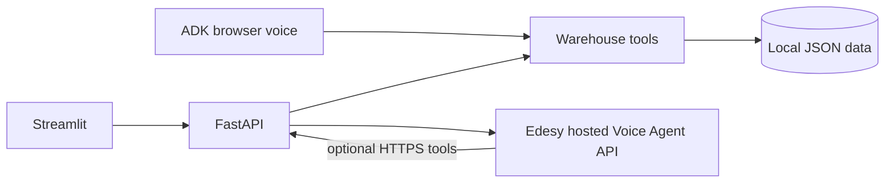

# WarehouseVoiceAI

Hackathon MVP: an AI voice + operator stack for warehouse and delivery support.

- **FastAPI** backend with simulated warehouse data (JSON)
- **Streamlit** operator dashboard
- **Edesy Hosted Voice Agent API** for outbound telephone calls
- **Google ADK** browser voice agent (separate from PSTN audio)

> Phone calls and the ADK browser mic session are **not** the same agent connection in this MVP. Warehouse tools are shared; audio paths are not.

## Architecture



## Features

| Feature | Status |
|---|---|
| Order / inventory / history lookup | Working (simulated JSON) |
| Delay risk heuristic | Working (simulated, labeled) |
| Feedback persistence | Working |
| Mock outbound calls | Working without credentials |
| Real outbound via Edesy | Working when key, agent id, credits configured |
| Call status / transcript refresh | Working against Edesy when live |
| Streamlit dashboard | Working |
| ADK browser voice + tools | Working when Google key + Live model configured |
| Hosted Edesy HTTP tools → FastAPI | Supported with public HTTPS URL |
| ADK audio on the phone call | **Not implemented** (needs SIP WebSocket bridge) |
| Inbound call routing | Requires Edesy number assignment — verify manually |

## Prerequisites

- Python 3.11+ (3.12 tested)
- Edesy account + API key (for live calls)
- Google AI Studio API key (for ADK browser voice)
- Mic/speakers for ADK demo

## Windows PowerShell setup

```powershell
cd <repo-root>
python -m venv .venv
.\.venv\Scripts\Activate.ps1
pip install -r requirements.txt
Copy-Item .env.example .env
# Edit .env — never commit it. Rotate any key that was pasted into chat.
```

### Environment

See `.env.example`. Important variables:

| Variable | Purpose |
|---|---|
| `MOCK_MODE` | `true` simulates outbound calls (default) |
| `EDESY_API_KEY` | Hosted Voice Agent API key (`vp_live_…`) |
| `EDESY_API_BASE_URL` | Default `https://voice-agent.edesy.in/api/v1` |
| `EDESY_AGENT_ID` | Numeric agent id from Edesy |
| `EDESY_FROM_NUMBER` | Optional caller ID |
| `PUBLIC_BASE_URL` | Public HTTPS base for Edesy HTTP tools / callbacks |
| `GOOGLE_API_KEY` | ADK / Gemini |
| `ADK_MODEL` | Live-capable Gemini model id |

SIP fields (`EDESY_ACCOUNT_SID`, `EDESY_APPLICATION_SID`) belong to a different Edesy product and are unused here.

## Run the backend

```powershell
.\.venv\Scripts\Activate.ps1
$env:MOCK_MODE = "true"
python -m uvicorn app.main:app --host 127.0.0.1 --port 8765 --reload
```

Health check: [http://127.0.0.1:8765/health](http://127.0.0.1:8765/health)

## Run the dashboard

```powershell
.\.venv\Scripts\Activate.ps1
$env:WAREHOUSE_API_BASE = "http://127.0.0.1:8765"
streamlit run dashboard/app.py --server.port 8510
```

Open the Streamlit URL shown in the terminal.

## Run the ADK browser voice agent

```powershell
.\.venv\Scripts\Activate.ps1
$env:GOOGLE_GENAI_USE_ENTERPRISE = "FALSE"
# $env:GOOGLE_API_KEY = "<your-key>"   # prefer .env
$env:SSL_CERT_FILE = (python -m certifi)
cd app
adk web --port 8035
```

Select `agent` (warehouse_voice_agent), reload, use the microphone. Ask for order `ORD-1001` or product `SKU-B210`.

This is a **browser** voice demo. It does not place a phone call.

## Edesy account & outbound setup

1. Rotate leaked keys; create a new API key with call/agent scopes.
2. Create an agent in Edesy (prompt + Live LLM provider).
3. Put `EDESY_API_KEY` and `EDESY_AGENT_ID` in `.env`.
4. Confirm wallet credits.
5. Set `MOCK_MODE=false`.
6. Use **Make a Call** in the dashboard with confirmation enabled.

Optional — let the hosted phone agent call your tools:

```powershell
$env:PUBLIC_BASE_URL = "https://your-public-https-url"
python scripts/register_edesy_functions.py --yes
```

## Inbound calls

Inbound only works if an Edesy phone number is assigned to your agent in the Edesy workspace. This repo does not auto-provision numbers. Verify in the Edesy dashboard before demoing inbound.

## Testing

```powershell
.\.venv\Scripts\Activate.ps1
pytest -q
```

Tests use mocked HTTP for Edesy and never place real calls.

## Mock mode

With `MOCK_MODE=true` (default):

- Dashboard, orders, inventory, delay risk, feedback work offline
- Outbound calls write simulated records labeled `is_mock`
- No telephony credits are consumed

## Known limitations

- ADK browser agent ≠ phone audio session
- Delay risk is a transparent heuristic, not ML
- Sample data is simulated
- Edesy call-ended callbacks are unsigned; app re-fetches provider state
- JSON files are for hackathon demos, not multi-writer production scale

## Security & privacy

- Never commit `.env`
- Never expose API keys to Streamlit or browser clients
- Rotate keys if they appeared in chat, screenshots, or logs
- Do not put real customer PII into the sample JSON for public demos

## Cost considerations

- Edesy outbound minutes / credits are billable
- Gemini Live / ADK usage is billable on your Google project
- Prefer `MOCK_MODE` while building UI and tests

## Docs

- [docs/INTEGRATION_NOTES.md](docs/INTEGRATION_NOTES.md)
- [docs/ARCHITECTURE.md](docs/ARCHITECTURE.md)
- [docs/TROUBLESHOOTING.md](docs/TROUBLESHOOTING.md)

## Manual checklist (you)

1. Rotate Edesy + Gemini keys that were shared in chat
2. Verify Edesy credits, agent id, and a dashboard Test Call
3. Confirm Google Live model access for ADK
4. Only then set `MOCK_MODE=false` for a live dial
